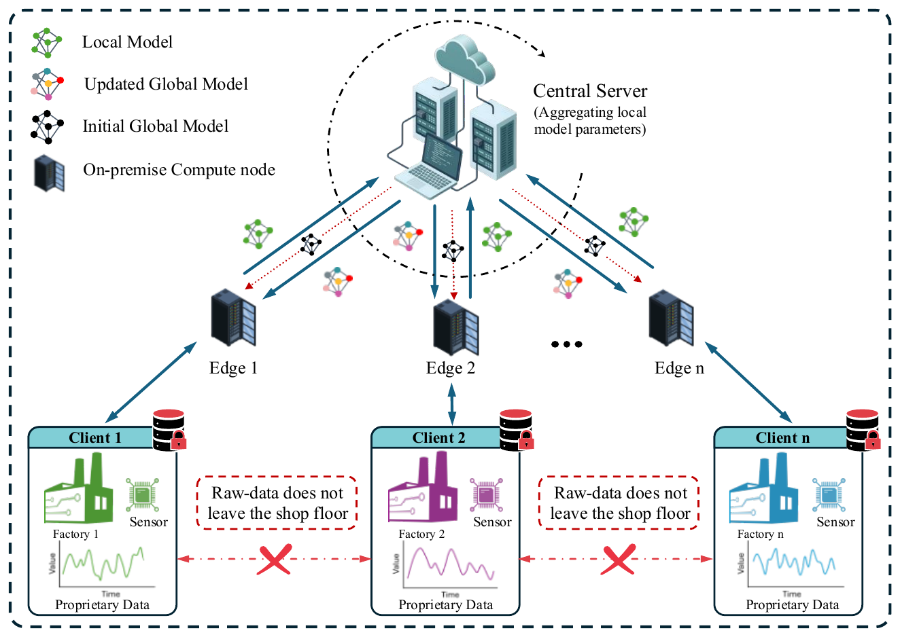
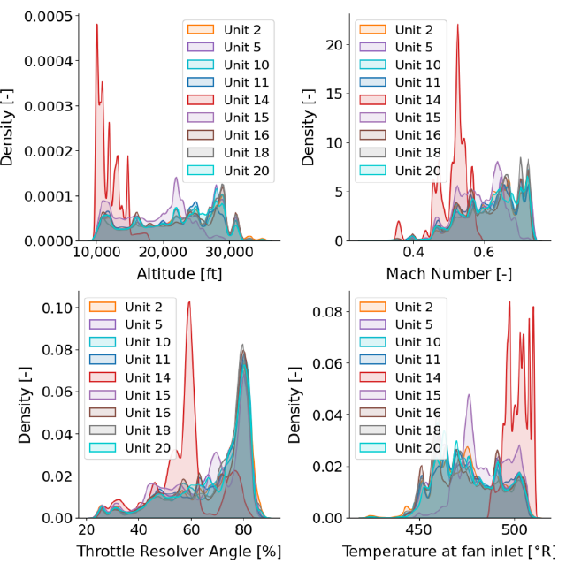
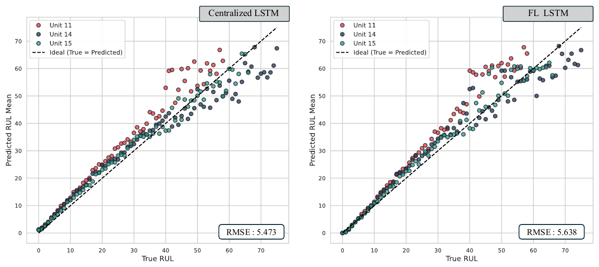
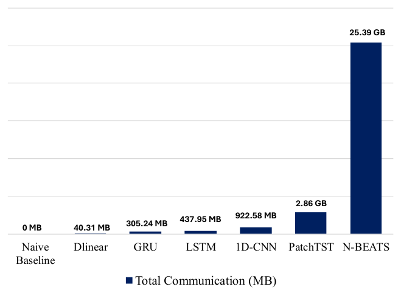
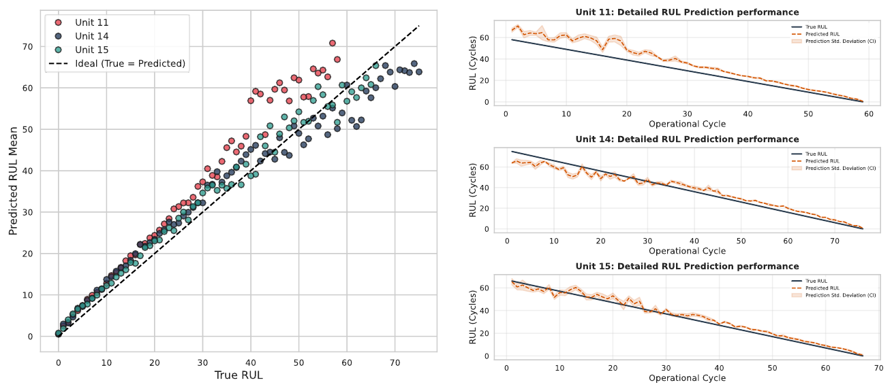
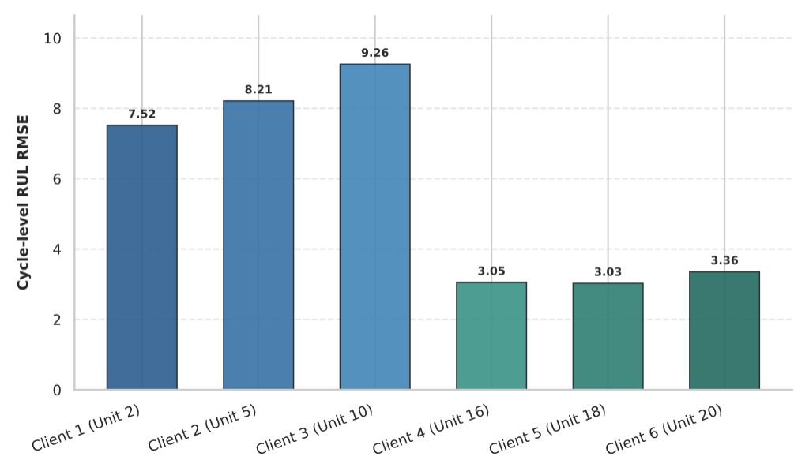
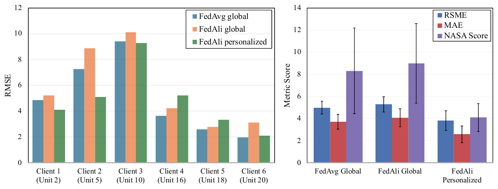

# Federated Learning for Predictive Maintenance in Smart Manufacturing

**Train Remaining Useful Life (RUL) models across machines, production lines or plants without
sharing raw sensor data.**

Code and result tables for the paper:

> **Federated Learning for Smart Manufacturing: Comparative Evaluation of Deep Learning Models
> for Federated Remaining Useful Life Prediction.**
> Md Irfan Khan, Wade Little, Austin D. Harper, Mojtaba A. Farahani, Thorsten Wuest.
> University of South Carolina. (Extended version of an APMS 2025 conference paper.)

---

## The manufacturing problem

Predictive maintenance needs a good RUL model, and a good RUL model needs run-to-failure data
from many machines. In practice, that data is spread across machines, lines, plants, suppliers
and customers. Each site usually has too little failure history to train a reliable model alone.
Pooling everything in one place is often not an option either:

- Sensor data can reveal process know-how, equipment behavior and production volumes.
- Moving high-frequency sensor streams to a central server costs bandwidth and storage, and it
  widens the attack surface.
- Machines doing the same job still run under different loads, settings and maintenance
  histories, so their data is non-IID.

**Federated learning (FL)** addresses this. Each site trains on its own data, and only model
updates leave the shop floor. A central server combines those updates into a shared model that
has learned from every site's degradation behavior.

<p align="center">
  
</p>
<p align="center"><em>Federated learning workflow. Raw sensor data stays on each site; only model
parameters travel to the server and back.</em></p>

This repository provides an **end-to-end federated RUL pipeline** (data partitioning, federated
training, centralized baseline, evaluation on unseen equipment and personalization) together with
a **comparative evaluation** of seven deep learning models on one benchmark. The models are
compared on prediction accuracy, communication cost, model size, training time and inference
latency.

The results show the **trade-offs** to consider when choosing a model. They are not a universal
ranking. Which model works best depends on your data: sensor set, sampling rate, cycle length,
degradation modes, number of sites and how different the sites are. Use the pipeline to rerun the
comparison on your own assets before committing to a model.

## What the benchmark shows

Results on N-CMAPSS DS02 engines the federation never saw during training (mean ± std over 3
seeds; RUL in cycles):

| Model | RMSE | NASA score ↓ | Parameters | Total communication |
|---|---|---|---|---|
| LSTM | 5.51 ± 0.11 | 119.1 ± 5.2 | 228 K | 438 MB |
| 1D-CNN | 5.62 ± 0.35 | **111.1 ± 7.1** | 481 K | 923 MB |
| DLinear | 5.71 ± **0.04** | 129.5 ± 2.3 | **21 K** | **40 MB** |
| GRU | 6.17 ± 0.07 | 136.2 ± 5.8 | 159 K | 305 MB |
| PatchTST | 6.64 ± 0.76 | 162.8 ± 43.1 | 1.5 M | 2.86 GB |
| N-BEATS | 7.91 ± 1.76 | 227.9 ± 99.9 | 13.2 M | 25.39 GB |
| Naive baseline | 20.57 ± 0.31 | 1562.3 ± 158.5 | 1 | — |

The NASA score penalizes late predictions (RUL overestimated, so maintenance comes too late) more
heavily than early ones. Lower is safer.

What we observed on this benchmark, and what it suggests for similar deployments:

| Deployment concern | Observation on this benchmark | Candidate models to evaluate first |
|---|---|---|
| Limited bandwidth, small edge devices, or many sites | DLinear came within 0.2 RMSE of the best model with about 1/10 the communication of LSTM, and it varied least across seeds. | Lightweight linear models such as DLinear |
| A late failure prediction is costly or unsafe | 1D-CNN had the lowest NASA score, meaning the fewest late (overestimated) predictions. | Convolutional models such as 1D-CNN |
| Average accuracy is the priority | LSTM had the lowest RMSE, but it was among the slowest to train. | Recurrent models such as LSTM or GRU |
| Communication budget and run-to-run stability | N-BEATS and PatchTST were the largest to communicate and varied most across seeds in this setup. | Consider them only with enough bandwidth and tuning effort |
| Is FL less accurate than pooling the data? | Not here. A matched centralized LSTM reached RMSE 5.58 ± 0.09 versus 5.51 ± 0.11 federated. | — |
| Should every site use a personalized model? | Not automatically. Personalization (FedAli) helped 4 of 6 sites and hurt 2. | Compare global and personalized models on each site's own validation data |

These are starting points, not prescriptions. A different dataset, feature set, window length or
amount of non-IID data between sites can change the ranking. The pipeline is built so that you
can swap in your own data and rerun the full comparison (see
[Adapting to your own data](#adapting-to-your-own-data)).

## About the data

Public run-to-failure data from real factories is scarce, so this study uses the NASA N-CMAPSS
(C-MAPSS 2) turbofan dataset as a stand-in for a fleet of industrial assets. Each engine plays
the role of one machine or plant. The engines run different flight profiles and degrade in
different ways, much as machines under different loads and settings do. Two of the three test
engines run noticeably different operating profiles from the training engines, so they test how
well a model carries over to new equipment.

<p align="center">
  
</p>
<p align="center"><em>Operating-condition distributions per engine. Test units 14 and 15 run
shorter, lower-altitude missions than the training engines, which mimics deploying a model on
a machine with a different duty cycle.</em></p>

The federated setup, evaluation protocol and code apply to any multivariate sensor dataset with
run-to-failure histories. To use your own data, see [Adapting to your own data](#adapting-to-your-own-data).

## Study setup

| | |
|---|---|
| Dataset | N-CMAPSS DS02 (`N-CMAPSS_DS02-006.h5`) |
| Clients | 6 sites, one engine each: units 2, 5, 10, 16, 18, 20 |
| Unseen test engines | Units 11, 14, 15 |
| Models | DLinear, GRU, LSTM, 1D-CNN, PatchTST, N-BEATS, naive baseline |
| Aggregation | FedAvg; FedAli (personalized, LSTM only) |
| Protocol | 40 rounds × 1 local epoch, all 6 clients every round, 512-step windows |
| Seeds | 42, 100, 456 |
| Framework | NVIDIA FLARE 2.7.2, PyTorch 2.5.1 |

---

## Results in detail

Figure and table numbers refer to the paper. Unless stated otherwise, results are mean ± std over
seeds 42, 100 and 456, computed at the cycle level on the unseen engines (units 11, 14, 15).

### 1. Federated vs. centralized training (Table 4, Fig. 4)

The centralized LSTM was trained on exactly the same data, splits and scalers as the federated
LSTM, so the only difference is whether the data was pooled.

| Configuration | RMSE | MAE | NASA score |
|---|---|---|---|
| Centralized LSTM | 5.58 ± 0.09 | 4.16 ± 0.02 | 118.3 ± 4.3 |
| Federated LSTM | 5.51 ± 0.11 | 4.10 ± 0.04 | 119.1 ± 5.2 |
| Gap (Fed − Cent) | −0.07 (−1.2%) | −0.06 (−1.5%) | +0.8 (+0.7%) |

<p align="center">
  
</p>
<p align="center"><em>Predicted vs. true RUL on the unseen engines, centralized (left) and
federated (right) LSTM, seed 42.</em></p>

**Takeaway for manufacturers:** the gap is smaller than the run-to-run variation of either method.
Keeping data on site cost no measurable accuracy here.

### 2. Communication cost (Fig. 5)

Total data exchanged over 40 rounds with 6 sites (upload + download, 32-bit weights):

<p align="center">
  
</p>

**Takeaway:** DLinear needs about 40 MB for the whole training run. N-BEATS needs over 25 GB,
more than 600 times as much, and is also less accurate. For sites on constrained or metered
networks, model size matters as much as accuracy.

### 3. Training time and inference latency (Table 3)

Measured on 2× NVIDIA RTX A5000 with all six sites training concurrently. Latency is for one
512-step input window.

| Model | Time per round (min) | Total, 40 rounds (h) | GPU latency (ms) | CPU latency (ms) |
|---|---|---|---|---|
| Naive | 5.2 | 3.5 | 0.004 | 0.004 |
| DLinear | 5.6 | 3.7 | 0.257 | 0.187 |
| PatchTST | 6.3 | 4.2 | 0.516 | 0.627 |
| N-BEATS | 6.2 | 4.1 | 0.543 | 2.583 |
| 1D-CNN | 6.9 | 4.6 | 0.566 | 1.773 |
| GRU | 6.3 | 4.2 | 0.952 | 20.275 |
| LSTM | 7.1 | 4.7 | 2.292 | 3.429 |
| LSTM + FedAli | 7.9 | 5.2 | 2.456 | 3.817 |

**Takeaway:** every model runs in milliseconds per prediction, so any of them can run online.
DLinear is the fastest on CPU, which matters for edge devices without a GPU. Source data:
[`results/figures_data/deployment_metrics.csv`](results/figures_data/deployment_metrics.csv).

### 4. How predictions track degradation (Fig. 6)

<p align="center">
  
</p>
<p align="center"><em>Federated DLinear on the unseen engines, seed 42: predicted vs. true RUL
(left) and RUL over time for each engine (right).</em></p>

The model follows the downward RUL trend well. Errors are largest early in life, when a healthy
engine's sensor readings look much like any other healthy engine's, and shrink as degradation
becomes visible in the signals.

Per-engine RMSE for DLinear: **unit 11: 8.16 ± 0.21**, unit 14: 5.18 ± 0.39, unit 15:
3.01 ± 0.12. The same ordering holds for every model. Unit 11 is consistently over-predicted,
which is the unsafe direction, and it alone accounts for about 55% of DLinear's NASA score. Unit 14,
the engine with the most different operating profile, shows almost no bias.

### 5. Performance at each participating site (Fig. 7)

The final global DLinear model evaluated on each site's own held-out cycles:

<p align="center">
  
</p>

**Takeaway:** one shared model does not serve every site equally. Sites 1–3 (units 2, 5, 10; HPT
failure mode only) see errors of 7.5–9.3 cycles, while sites 4–6 (units 16, 18, 20; combined
HPT + LPT failure mode) see about 3. Check per-site performance before deploying a global model.

### 6. Personalized federated learning with FedAli (Fig. 8, Table 6)

FedAli adds prototype-based alignment to FedAvg, so each site keeps a personalized version of the
shared model. Evaluated on each site's held-out cycles:

| | RMSE | NASA score |
|---|---|---|
| FedAli global model | 5.27 ± 0.69 | 8.98 ± 3.60 |
| FedAli personalized | **3.82 ± 0.89** | **4.08 ± 1.27** |

<p align="center">
  
</p>
<p align="center"><em>Per-site RMSE (left) and averages across sites (right); error bars show
the standard deviation over three seeds.</em></p>

On average, personalization helps, but not at every site:

| Site | RUL shift | Mean feature shift | Median KS shift | Cross-site difference | RMSE change with personalization |
|---|---|---|---|---|---|
| Client 1 (unit 2) | 0.046 | 0.034 | 0.051 | 0.551 | −21.3% |
| Client 2 (unit 5) | 0.281 | 0.123 | 0.087 | 0.368 | **−42.9%** |
| Client 3 (unit 10) | 0.285 | 0.077 | 0.085 | 0.675 | −8.4% |
| Client 4 (unit 16) | 0.054 | 0.297 | 0.225 | 1.373 | **+23.3%** (worse) |
| Client 5 (unit 18) | 0.280 | 0.105 | 0.125 | 1.690 | **+20.5%** (worse) |
| Client 6 (unit 20) | 0.025 | 0.200 | 0.152 | 0.601 | −33.4% |

Sites 4 and 5 got worse. They were already the sites where the global model performed best.
Site 4 also had the largest shift between its training and test data, so its personalized
model learned patterns that did not hold later. This is negative transfer.

**Implication for deployment:** in this study, the benefit of personalization depended on the
site. A practical approach is to keep both models available at each site, and use the
personalized model only where it beats the global model on that site's own validation data.

---

## Contents

- [Results in detail](#results-in-detail)

1. [Repository layout](#1-repository-layout)
2. [Mapping to the paper](#2-mapping-to-the-paper)
3. [Installation](#3-installation)
4. [Data preparation](#4-data-preparation)
5. [Running federated training](#5-running-federated-training)
6. [Evaluation](#6-evaluation)
7. [Centralized baseline](#7-centralized-baseline)
8. [Configuration reference](#8-configuration-reference)
9. [Troubleshooting](#9-troubleshooting)
- [Adapting to your own data](#adapting-to-your-own-data)
10. [Citation](#10-citation)

---

## 1. Repository layout

```text
.
├── data_preparation/
│   └── create_client_datasets.py   DS02 .h5  ->  per-client .npz + unseen-test .npz
├── federated_jobs/                 NVFlare jobs, one folder per model × seed
│   └── C-MAPSS_RUL_<MODEL>[_seed100|_seed456]/      (no suffix = seed 42)
│       ├── meta.conf                                 min_clients = 6
│       └── app/
│           ├── config/config_fed_server.conf         rounds, aggregator, model selector
│           ├── config/config_fed_client.conf         client launcher, timeouts
│           └── custom/
│               ├── train.py              local training loop + TrainConfig (hyperparameters)
│               ├── data_loader.py        features, windowing, cycle-level splits, local scalers
│               ├── <MODEL>_model.py      network definition
│               ├── fedavg_algorithm.py / fedali_algorithm.py
│               ├── nvflare_*_aggregator.py
│               └── site_gpu_launcher.py  pins each site to a GPU
├── scripts/RUL/                    metric export, evaluation, multi-seed aggregation
├── Centralized_Study/RUL/          matched centralized LSTM baseline
├── Workspace/project.yml           NVFlare provisioning spec (1 server, 6 clients, 1 admin)
├── docs/figures/                   paper figures shown in this README
└── results/                        summary tables behind the numbers in the paper
    ├── federated/multi_seed_summary/   Table 5 (mean ± std over seeds)
    ├── federated/Seed_<s>/<model>/     per-seed unseen-engine and local-client summaries
    ├── centralized/                    Table 4, centralized side
    └── figures_data/                   Fig. 8 data and Table 3 timing/latency
```

The dataset, provisioned startup kits, job archives and model checkpoints are not tracked
(see `.gitignore`). You generate them by following the steps below.

Every command runs from the repository root:

```bash
export FL_ROOT="$(pwd)"
```

---

## 2. Mapping to the paper

| Paper item | Produced by | Stored result |
|---|---|---|
| Data partition (Table 1) | `data_preparation/create_client_datasets.py`, `data_loader.py` | — |
| Model configurations (Table 2) | `federated_jobs/*/app/custom/<MODEL>_model.py` | — |
| Training time and latency (Table 3) | NVFlare round summaries (`export_fl_job_metrics.py`) | `results/figures_data/deployment_metrics.csv` |
| Centralized vs federated (Table 4, Fig. 4) | `Centralized_Study/RUL/centralized_lstm_matched.py`, `aggregate_matched_seeds.py` | `results/centralized/` |
| Model comparison on unseen engines (Table 5) | `scripts/RUL/evaluate_single_seed.py`, `aggregate_multi_seed_results.py` | `results/federated/multi_seed_summary/paper_table.csv` |
| Per-client RMSE (Fig. 7) | `scripts/RUL/evaluate_global_model_local_clients.py` | `results/federated/Seed_42/DLinear/local_clients/` |
| FedAli personalization (Fig. 8, Table 6) | `scripts/RUL/evaluate_fedali_perspectives.py`, `aggregate_figure8_errorbars.py` | `results/figures_data/Figure8_*.csv`, `results/centralized/fedali_personalization_verified.csv` |

| Paper model name | Job folder | `--model` key in scripts |
|---|---|---|
| DLinear | `C-MAPSS_RUL_DLinear` | `DLinear` |
| GRU | `C-MAPSS_RUL_GRU` | `GRU` |
| LSTM (FedAvg) | `C-MAPSS_RUL_LSTM_FedAvg` | `LSTM_FedAvg` |
| LSTM (FedAli) | `C-MAPSS_RUL_LSTM_FedAli` | `LSTM_FedAli` |
| 1D-CNN | `C-MAPSS_RUL_1D-CNN` | `1D-CNN` |
| PatchTST | `C-MAPSS_RUL_PatchTST` | `PatchTST` |
| N-BEATS | `C-MAPSS_RUL_NBeats` | `N-BEATS` |
| Naive baseline | `C-MAPSS_RUL_Naive_Baseline` | `Naive` |

---

## 3. Installation

**Hardware used for the paper:** Linux workstation, AMD Threadripper PRO 5975WX, 503 GiB RAM,
2× NVIDIA RTX A5000. All six clients run on one machine. Sites 1–3 use GPU 0 and sites 4–6 use
GPU 1 by default. One 40-round job takes about 3.5–5 hours.

```bash
conda create -n nvflare python=3.9 -y
conda activate nvflare

pip install torch==2.5.1 --index-url https://download.pytorch.org/whl/cu121
pip install -r requirements.txt
```

Check the install:

```bash
python -c "import nvflare, torch; print(nvflare.__version__, torch.__version__, torch.cuda.is_available())"
# 2.7.2 2.5.1+cu121 True
```

---

## 4. Data preparation

### 4.1 Download the raw data

Download **N-CMAPSS** (`17.Turbofan_Engine_Degradation_Simulation_Data_Set_2.zip`) from the
NASA Prognostics Center of Excellence data repository and extract `N-CMAPSS_DS02-006.h5` (~2.3 GB):

<https://www.nasa.gov/intelligent-systems-division/discovery-and-systems-health/pcoe/pcoe-data-set-repository/>

### 4.2 Build the client files

```bash
python data_preparation/create_client_datasets.py \
  --h5 /path/to/N-CMAPSS_DS02-006.h5 \
  --out-dir data/fl_dataset_ds02_006
```

The script writes the following files (~1.3 GB in total):

```text
client_unit_2.npz   client_unit_5.npz   client_unit_10.npz
client_unit_16.npz  client_unit_18.npz  client_unit_20.npz
test_units_11_14_15.npz
manifest.csv
```

Each `.npz` holds one 1-D array per column (`unit`, `cycle`, flight conditions, measured and
virtual sensors). The RUL label is not stored. `data_loader.py` computes it at load time as
`RUL = max_cycle(unit) − cycle`. The loader also applies a cap of 125, but it never takes effect
here because no DS02 unit has more than 89 cycles.

The script reproduces the exact `.npz` files used for the paper (verified byte-for-byte).

### 4.3 Provision NVFlare and place the data

Create the startup kits (server, six sites, admin):

```bash
cd $FL_ROOT/Workspace
nvflare provision -p project.yml -w .
cd $FL_ROOT
```

`-w .` makes NVFlare write into `Workspace/example_project/prod_00/`, the location the scripts
expect. If provisioning creates `prod_01` or a later folder, use that path below and pass
`--site-data-root` to the evaluation scripts.

Each site receives only its own engine. The unseen-test file goes in `Workspace/data/`:

```bash
D=data/fl_dataset_ds02_006
W=$FL_ROOT/Workspace/example_project/prod_00

mkdir -p $FL_ROOT/Workspace/data
cp $D/test_units_11_14_15.npz $FL_ROOT/Workspace/data/

for pair in "1:2" "2:5" "3:10" "4:16" "5:18" "6:20"; do
  site="${pair%%:*}"; unit="${pair##*:}"
  mkdir -p "$W/site-$site/local/data"
  cp "$D/client_unit_${unit}.npz" "$W/site-$site/local/data/"
done
```

| Site | Engine unit | Site | Engine unit |
|---|---|---|---|
| site-1 | 2 | site-4 | 16 |
| site-2 | 5 | site-5 | 18 |
| site-3 | 10 | site-6 | 20 |

### 4.4 Smoke test

Before starting the federation, check that one client file loads and trains:

```bash
cd $FL_ROOT/federated_jobs/C-MAPSS_RUL_LSTM_FedAvg/app/custom
python train.py --mode smoke --data-path $FL_ROOT/Workspace/example_project/prod_00/site-1/local/data
cd $FL_ROOT
```

---

## 5. Running federated training

### 5.1 Start the server, clients and admin console

```bash
W=$FL_ROOT/Workspace/example_project/prod_00

$W/server/startup/start.sh                          # wait until server/log.txt shows port 8002
for s in 1 2 3 4 5 6; do $W/site-$s/startup/start.sh; done
$W/admin@nvidia.com/startup/fl_admin.sh             # log in as admin@nvidia.com
```

In the admin console, `check_status server` should list six clients. Jobs will not start with
fewer, because `min_clients = 6`.

On a machine with one GPU, set this before starting the clients:

```bash
export FL_GPU_MAP="site-1:0,site-2:0,site-3:0,site-4:0,site-5:0,site-6:0"
```

### 5.2 Submit jobs

Submit one job at a time, using the absolute path:

```text
> submit_job /absolute/path/to/repo/federated_jobs/C-MAPSS_RUL_DLinear
> list_jobs
```

Write down the job ID that NVFlare returns. You need it for every evaluation step. Repeat for
each model and seed. For the full paper, that is 8 job types × 3 seeds = 24 jobs.

When a job finishes, NVFlare archives it to `Workspace/jobs-storage/<JOB_ID>/`. The final global
model is `workspace/app_server/FL_global_model.pt`. The best model by validation RMSE is
`best_FL_global_model.pt`. The paper reports the **final** model (`FL_global_model.pt`).

### 5.3 Monitor

```bash
tensorboard --logdir Workspace/example_project/prod_00 --port 6006
tail -f Workspace/example_project/prod_00/site-1/log.txt
python scripts/RUL/export_fl_job_metrics.py <JOB_ID>      # round-level CSVs, timing, communication
```

`export_fl_job_metrics.py` writes `round_summary.csv` (per-round duration, used for Table 3),
`client_round_metrics.csv` and related files to `Workspace/fl_artifacts/job_metrics/<JOB_ID>/`.

### 5.4 Shut down

```text
> shutdown client
> shutdown server
```

---

## 6. Evaluation

All metrics are computed at the **cycle level**: window predictions are averaged per
(unit, cycle) before RMSE, MAE and NASA score are computed.

### 6.1 Unseen engines, one model at one seed (Table 5 inputs)

```bash
python scripts/RUL/evaluate_single_seed.py \
  --model DLinear --seed 42 --job-id <JOB_ID> \
  --base-results-dir Workspace/fl_artifacts
```

This wraps `evaluate_global_model_unseen.py`. That script inverse-transforms predictions
with a pooled scaler built only from the six clients' training splits (Eq. 12 in the paper). Output:
`Workspace/fl_artifacts/Seed_<seed>/<model>/unseen_engines/summary_table.csv`.

### 6.2 Aggregate across seeds (Table 5)

```bash
python scripts/RUL/aggregate_multi_seed_results.py \
  --base-results-dir Workspace/fl_artifacts \
  --seeds 42 100 456 \
  --models DLinear GRU LSTM_FedAvg 1D-CNN PatchTST N-BEATS LSTM_FedAli Naive
```

Output: `Workspace/fl_artifacts/multi_seed_summary/paper_table.csv` (and a LaTeX version).
Compare it with `results/federated/multi_seed_summary/paper_table.csv`.

### 6.3 Global model on each client's held-out cycles (Fig. 7)

```bash
python scripts/RUL/evaluate_global_model_local_clients.py \
  --job-id <JOB_ID> --checkpoint FL_global_model.pt --seed 42
```

Pass the same `--seed` the job was trained with, so the script rebuilds the same cycle splits.

### 6.4 FedAli personalization (Section 3.3, Fig. 8, Table 6)

```bash
python scripts/RUL/evaluate_fedali_perspectives.py --job-id <FEDALI_JOB_ID> --seed 42 --state latest
```

This evaluates the FedAli global model and the personalized model (each client's retained
prototype bank) on every client's held-out cycles. Output goes to
`Workspace/fl_artifacts/fedali_perspectives/<JOB_ID>/`. After running it for all three seeds,
build the Fig. 8 error-bar data:

```bash
python scripts/RUL/aggregate_figure8_errorbars.py \
  --fedavg-jobs <LSTM_FEDAVG_JOB_42> <..._100> <..._456> \
  --fedali-dirs Workspace/fl_artifacts/fedali_perspectives/<FEDALI_JOB_42> <..._100> <..._456>
```

### 6.5 Communication cost (Fig. 5)

Communication is computed analytically (Eq. 11): `2 × params × 4 bytes × 40 rounds × 6 clients`.
For example, DLinear gives 2 × 20,995 × 4 × 40 × 6 ≈ 40.3 MB.

---

## 7. Centralized baseline

The centralized LSTM uses the same six units, the same per-unit 70/15/15 cycle split, the same
features and the same model code as the federated LSTM. It imports `data_loader.py`, `train.py`
and `LSTM_model.py` directly from `federated_jobs/C-MAPSS_RUL_LSTM_FedAvg/app/custom/`.

```bash
for s in 42 100 456; do
  python Centralized_Study/RUL/centralized_lstm_matched.py --seed $s
done
python Centralized_Study/RUL/aggregate_matched_seeds.py
```

The script looks for data in `Centralized_Study/data/` first. If it is not there, it uses the
site folders under `Workspace/example_project/prod_00/` and `Workspace/data/`. Results go to
`Centralized_Study/RUL/outputs/matched/`. Compare them with `results/centralized/`.
`aggregate_matched_seeds.py` reads the federated numbers from
`Workspace/fl_artifacts/multi_seed_summary/paper_table.csv`, so run §6.2 first.

---

## 8. Configuration reference

Hyperparameters are in `TrainConfig` in each job's `app/custom/train.py`. NVFlare ships
`app/custom/` to the clients when a job is submitted, so edit the job folder and resubmit to
change anything.

| Setting | Value |
|---|---|
| Input window / stride / target offset | 512 / 1 / 0 |
| Input features | 25 (see below) |
| Local epochs per round | 1 |
| Optimizer | AdamW, lr 5e-4, weight decay 1e-4, grad clip 1.0 |
| Loss | Huber (δ = 1) on standardized targets |
| Batch size | 64 (DLinear, GRU, 1D-CNN, PatchTST, N-BEATS, Naive); 256 (LSTM FedAvg and FedAli) |
| Split per client | 70 / 15 / 15 train / val / test, by whole flight cycle, seeded shuffle |
| Normalization | Per-client `StandardScaler` for inputs and target, fit on training windows only |
| Rounds / clients | 40 / 6 (`config_fed_server.conf`, `meta.conf`) |
| Client upload | weight differences (`params_transfer_type = DIFF`) |
| Model selection | `IntimeModelSelector` on validation RMSE |
| FedAli | 16 prototypes, β = 0.2 (see `federated_jobs/C-MAPSS_RUL_LSTM_FedAli/README.md`) |

Input features (`CENTRALIZED_FEATURE_COLS` in `data_loader.py`):

```text
alt, Mach, TRA, T2, T24, T30, T48, P15, P21, P24, Ps30, P40, P50,
Nf, Nc, Wf, P45, P30, W48, W50, W31, W32, W25, W22, T50
```

Seed variants (`_seed100`, `_seed456`) differ from the seed-42 folder only in `TrainConfig.seed`
and the job name. For FedAli, the prototype and K-means seeds also change.

---

## 9. Troubleshooting

| Symptom | Fix |
|---|---|
| Job stays queued | Fewer than 6 clients are connected. Check with `check_status server`. |
| A site exits immediately | Read `site-N/log_error.txt`. Usually the `.npz` is missing from `site-N/local/data/`. Run the smoke test (§4.4). |
| CUDA out of memory | Spread sites across GPUs with `FL_GPU_MAP`, or lower `batch_size` in the job's `train.py`. |
| All sites on GPU 0 | `FL_GPU_MAP` was exported after the clients started. Restart the clients. |
| Task timeout | Raise the 5400 s timeouts in `config_fed_server.conf` and `config_fed_client.conf`. |
| Matplotlib cache warnings | Prefix the command with `MPLCONFIGDIR=/tmp/matplotlib`. |

Startup kits contain private keys. Generate them yourself with `nvflare provision` and never
commit `Workspace/example_project/`.

---

## Adapting to your own data

The model comparison in this repository comes from one benchmark. To find the right model for
your own machines or plants, run the same pipeline on your data and compare all models with the
same evaluation scripts. Each site needs run-to-failure sensor history in the same `.npz`
format:

1. **One `.npz` file per site**, holding one 1-D array per column, all the same length:
   - `unit`: machine or asset ID
   - `cycle`: operating cycle, batch or job number. RUL is computed as
     `max_cycle(unit) − cycle`, so each unit's history must run until failure.
   - one array per sensor or operating-condition signal
2. **Pick the input features** by editing `CENTRALIZED_FEATURE_COLS` in each job's
   `app/custom/data_loader.py`.
3. **Match the model input size** to the number of features. The server builds the initial
   model from the default `input_size = 25` in `app/custom/<MODEL>_model.py`, so change that
   default too, or the client and server models won't match.
4. **Check the window length.** The 512-step window assumes every cycle has at least 512
   samples. If your cycles are shorter, lower `input_window` in `train.py` and pass the same
   `--window-size` to the evaluation scripts.
5. **Set the number of sites.** Add or remove clients in `Workspace/project.yml`, then change
   `min_clients` in `meta.conf` and `config_fed_server.conf`.

To deploy across real machines instead of one workstation, set `default_host` in
`Workspace/project.yml` to the server's hostname before provisioning. Then copy each site's
startup kit to that site.

---

## 10. Citation

If you use this code, please cite the paper and the dataset:

```bibtex
@article{khan_fl_rul,
  title  = {Federated Learning for Smart Manufacturing: Comparative Evaluation of Deep Learning
            Models for Federated Remaining Useful Life Prediction},
  author = {Khan, Md Irfan and Little, Wade and Harper, Austin D. and Farahani, Mojtaba A. and
            Wuest, Thorsten},
  note   = {Under review}
}

@article{arias2021ncmapss,
  title   = {Aircraft Engine Run-to-Failure Dataset under Real Flight Conditions for Prognostics
             and Diagnostics},
  author  = {Arias Chao, Manuel and Kulkarni, Chetan and Goebel, Kai and Fink, Olga},
  journal = {Data}, volume = {6}, number = {1}, pages = {5}, year = {2021},
  doi     = {10.3390/data6010005}
}
```

## Acknowledgment

This material is based upon work supported by the National Science Foundation under Grants
No. 2119654 and 2519581.

## License

MIT. See [LICENSE](LICENSE).
